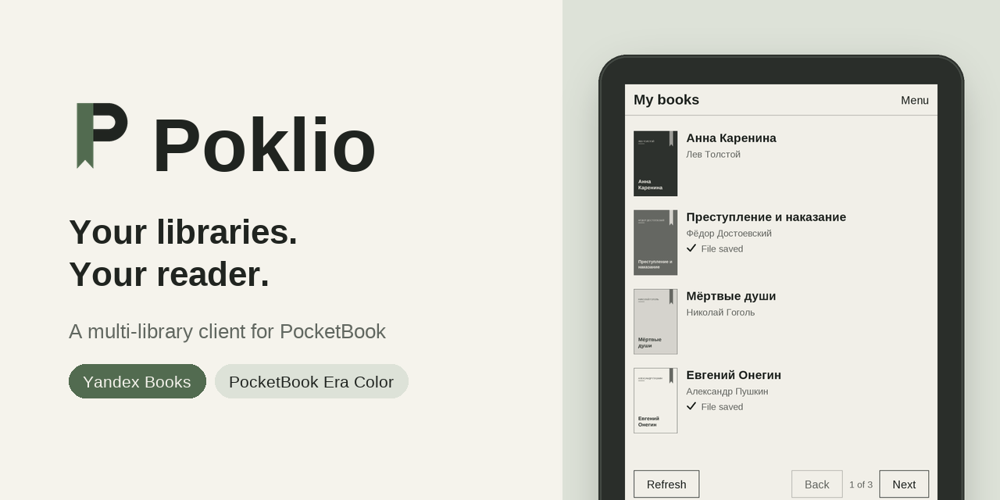
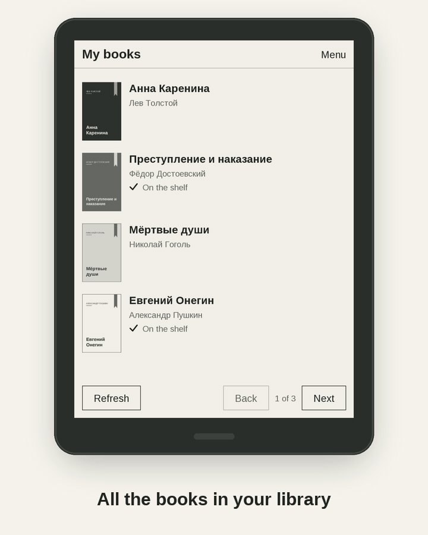
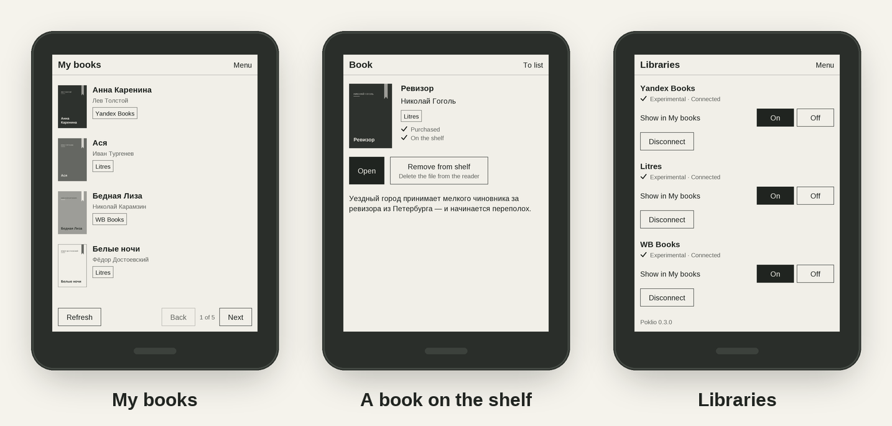
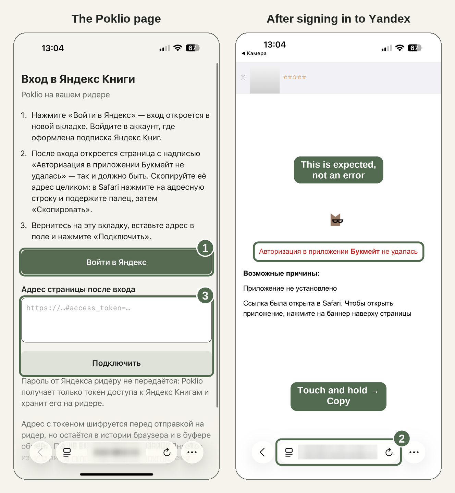

<p align="right"><a href="README.md">Русский</a> · <b>English</b></p>

<p align="center">
  
</p>

<h3 align="center">Books from your libraries, on your PocketBook. Over Wi-Fi, no computer needed.</h3>

<p align="center">
  <a href="https://github.com/ArkHak/poklio/releases/latest"></a>
  &nbsp;
  <a href="#get-started"></a>
  &nbsp;
  <a href="#installs"></a>
</p>

<p align="center">
  
</p>

## Why Poklio

<table>
  <tr>
    <td width="33%" valign="top">
      <b>All your libraries on your reader</b><br>
      Yandex Books, Litres and WB Books in one list, with covers and a tag showing each book's library.
    </td>
    <td width="33%" valign="top">
      <b>One tap to your shelf</b><br>
      Tap Put on shelf and it's in your reader's library, ready to open in the built-in reader app.
    </td>
    <td width="33%" valign="top">
      <b>Catalog search</b><br>
      Search the library you choose and open a book's page without reaching for your phone.
    </td>
  </tr>
  <tr>
    <td valign="top">
      <b>No password on the reader</b><br>
      Yandex Books and WB Books: scan a QR code with your phone. Litres: a code from an email or the Litres app.
    </td>
    <td valign="top">
      <b>Made for E Ink</b><br>
      Big buttons, page-turn keys and a color theme on Era Color.
    </td>
    <td valign="top">
      <b>Updates over Wi-Fi</b><br>
      A new version installs only when you tap Update. Interface in English and Russian.
    </td>
  </tr>
</table>

<p align="center">
  
  <br><sub>Screenshots. Books and covers are examples. Titles and descriptions come from the library catalog, so they stay in Russian.</sub>
</p>

## Installs

<picture>
  <source media="(prefers-color-scheme: dark)" srcset="https://raw.githubusercontent.com/ArkHak/poklio/stats/downloads.en.dark.svg">
  
</picture>

An estimate: downloads of the app from the releases page, not counting over-the-air updates, which are shown separately. Updated daily.

## Get started

<table>
  <tr>
    <td width="33%" valign="top">
      <b>1. Install</b><br>
      Download <code>poklio.app.bin</code> from the <a href="https://github.com/ArkHak/poklio/releases/latest">latest release</a>, rename it to <code>poklio.app</code> and copy it to the <code>applications</code> folder on your reader over USB.
    </td>
    <td width="33%" valign="top">
      <b>2. Connect</b><br>
      In Poklio, tap Connect a library. Yandex Books and WB Books: Sign in with phone and a QR code. Litres: Sign in with a code and a code from an email.
    </td>
    <td width="33%" valign="top">
      <b>3. Read</b><br>
      Pick a book in My books, tap Put on shelf, then Open.
    </td>
  </tr>
</table>

You'll need Wi-Fi and a Yandex Books or WB Books account with a subscription, or a Litres account with purchased books. To sign in with a phone, your phone and reader must be on the same network.

<details>
<summary><b>Signing in to Yandex Books, step by step</b></summary>

1. On the reader: Connect a library → Sign in with phone. A QR code appears.
2. Point your phone's camera at it and open the page.
3. Tap Sign in to Yandex and sign in to your account.
4. You'll land on a Yandex page saying that authorization in the Bookmate app failed (in Russian: «Авторизация в приложении Букмейт не удалась»). **This isn't an error**: Yandex Books used to be called Bookmate, and Poklio signs in through that app. Access is already in this page's address — it starts with `https://yx4483e97…oauth.yandex.ru` and contains `#access_token=`. Copy the page's full address: press and hold the address bar → Copy.
5. Go back to the Poklio tab, paste the address and tap Connect. My books opens on your reader.

The screenshot below is from a phone set to Russian.


</details>

<details>
<summary><b>Signing in to Litres, step by step</b></summary>

1. On the reader: Menu → Libraries → Sign in with a code under Litres.
2. Tap the field, enter the email of your Litres account and tap Get a code.
3. Litres emails you a code. Enter it and tap Sign in — My books opens.

If you have the Litres app on your phone, you can skip the email: tap Code from the app on the sign-in screen. In the Litres app: Profile → Sign-in information → Code for the Litres website → Get. The code is valid for 15 minutes.

Only purchased books without copy protection can be downloaded to the reader, and only as EPUB: if Litres has no EPUB for a book (for example, only a PDF), Poklio can't get it. Books from a Litres subscription can only be read in the Litres apps — Poklio tags them Only in the Litres app.
</details>

<details>
<summary><b>Signing in to WB Books, step by step</b></summary>

1. On the reader: Menu → Libraries → Sign in with phone under WB Books. A QR code appears.
2. Point your phone's camera at it and open the page.
3. Tap Sign in to WB ID, sign in with your phone number and the SMS code, then tap Accept.
4. A WB Books page with a Return to the app button opens — don't tap it. Copy that page's full address: touch and hold the address bar → Copy.
5. Go back to the Poklio tab, paste the address and tap Connect. My books opens on the reader.

If your WB ID profile opens instead of the WB Books page, go back to the Poklio tab and tap Sign in to WB ID again. The code in the address works only once: if it doesn't work, sign in again.

You can download books included in your active WB Books subscription; Poklio checks purchases too, but downloading a purchased book hasn't been tested yet. Audiobooks aren't shown in Poklio.
</details>

<details>
<summary><b>Installing from a Mac</b></summary>

Finder adds a hidden helper file to the reader, which shows up as an extra item in Applications. Copy the file in Terminal instead (`PB700K3` is your reader's name in Finder):

```bash
cp -X ~/Downloads/poklio.app /Volumes/PB700K3/applications/
```

If the extra item is already there, delete `applications/._poklio.app` from the reader.
</details>

<details>
<summary><b>Poklio icon in the menu (optional)</b></summary>

Without this setup, Poklio shows up in the Applications menu with the standard placeholder icon, like any third-party app. The firmware only takes custom icons from its own system menu file, and Poklio doesn't change system files. So you can add the icon by hand if you're comfortable carefully editing one text file.

> **Important.** A mistake in this file can break the Applications menu. Make a backup first (step 1) so you can undo everything in a minute. Tested on PocketBook 700 Era Color, firmware U700k3.6.10.2359; other firmware versions may lay out the file differently.

**1. Make a backup.** Connect the reader over USB and copy two files from the reader's `system/config/desktop/` folder to your computer: `view.json` and `hash.txt`.

**2. Add the icons.** Download [poklio.bmp](https://github.com/ArkHak/poklio/raw/main/icons/poklio.bmp) and [poklio_f.bmp](https://github.com/ArkHak/poklio/raw/main/icons/poklio_f.bmp) (the second one is shown when pressed). On the reader, create an `icons` folder inside `applications` and put both files there.

**3. Open `system/config/desktop/view.json`** in a plain text editor: VS Code, Notepad++, Notepad, or TextEdit in plain text mode. Word and similar apps won't work.

**4. Describe Poklio.** Near the top of the file, find the line `"applications": {`. Paste this block right below it — note the comma at the end:

```json
        "U_poklio": {
            "path": "/mnt/ext1/applications/poklio.app",
            "title": "Poklio",
            "icon": "/mnt/ext1/applications/icons/poklio.bmp",
            "focused_icon": "/mnt/ext1/applications/icons/poklio_f.bmp"
        },
```

It should look like this:

```json
    "applications": {
        "U_poklio": {
            "path": "/mnt/ext1/applications/poklio.app",
            "title": "Poklio",
            "icon": "/mnt/ext1/applications/icons/poklio.bmp",
            "focused_icon": "/mnt/ext1/applications/icons/poklio_f.bmp"
        },
        "_comment": [
            ...
```

**5. Add Poklio to the menu.** Further down, in the `"view"` section, find the group with `"title": "@General"` and its `"apps"` list. Add a comma after the last item and append `"U_poklio"`:

```json
                "apps": [
                    "PB_AudioBooks",
                    ...
                    "PB_Settings",
                    "U_poklio"
                ]
```

**6. Save the file** (UTF-8) and double-check the details: all quotes are straight `"`, and there are commas between items but not after the last one. Don't change `hash.txt` — the firmware updates it itself.

**7. Disconnect the reader.** The icon appears in the Applications menu. If it doesn't, restart the reader.

**On a Mac,** if Finder added hidden helper files, delete them, or an extra item may show up in the menu:

```bash
rm /Volumes/PB700K3/applications/icons/._*
```

**If something goes wrong** (the menu won't open, apps are missing, or Poklio won't start), connect the reader, put back `view.json` and `hash.txt` from your backup, and restart the reader.
</details>

<details>
<summary><b>Backup sign-in, using a computer</b></summary>

1. On your computer, open [this link](https://oauth.yandex.ru/authorize?response_type=token&client_id=4483e97bab6e486a9822973109a14d05) and sign in to Yandex.
2. On the page saying that authorization in the Bookmate app failed, copy the full address.
3. Save it to a text file named `yandex.token` and copy it to the `poklio` folder on your reader over USB (the folder appears after you first open Poklio).
4. Open Poklio. It connects the library and deletes the file.

The file gives access to your account: don't share it, and delete it from your computer.
</details>

## Security

<table>
  <tr>
    <td width="50%" valign="top">
      <b>What's protected</b>
      <ul>
        <li>You type your password only on the Yandex website. The reader never sees it. Litres needs no password: you sign in with a code that goes straight to Litres. For WB Books, you enter the SMS code only in your phone's browser; the reader gets a single-use sign-in code.</li>
        <li>Your sign-in data is encrypted over Wi-Fi and stored encrypted on the reader.</li>
        <li>The sign-in page only works while the sign-in screen is open, for up to 10 minutes.</li>
        <li>The reader won't install an update without the author's valid signature.</li>
      </ul>
    </td>
    <td width="50%" valign="top">
      <b>What you should do</b>
      <ul>
        <li>After signing in, delete the Yandex or WB Books page from your browser history and copy some other text.</li>
        <li>Sign in on your own network, not a public one.</li>
        <li>Protection on the reader guards against stray copies of its memory, not against someone holding the reader itself. If you lose your reader or give it away, revoke access in <a href="https://id.yandex.ru/personal/data-access">Yandex ID → Data access</a>; for Litres, contact Litres support to end your sessions; for WB Books, end the session in your WB ID profile (Sessions).</li>
      </ul>
    </td>
  </tr>
</table>

## FAQ

<details>
<summary><b>Is this an official Yandex, Litres, Wildberries or PocketBook app?</b></summary>

No. Poklio is an independent project, not affiliated with PocketBook, Yandex, Litres, Wildberries or any other company. Service names are used only to show compatibility. Poklio connects to Yandex Books, Litres and WB Books unofficially, so the connection is marked as experimental: if a service changes something, Poklio may stop working until an update.
</details>

<details>
<summary><b>Can I get a book that isn't in my subscription?</b></summary>

No. Poklio only gets books your account can read in full, and it doesn't bypass service restrictions. For Litres, these are your purchased books; books from a Litres subscription can't be downloaded to the reader — the service only serves them to its own apps. For WB Books, these are books from your active subscription and purchased books. Poklio doesn't promise access after the subscription ends; files already on the reader stay there.
</details>

<details>
<summary><b>Which readers does it work on?</b></summary>

It needs firmware 6.8 or later. Poklio 0.1.0 didn't start on firmware 6.8 — fixed in 0.1.1. A user report confirms it also starts and works on firmware 6.5 (PocketBook X).

Tested models:

| Model | Firmware | Poklio | What was tested | Date | Tested by |
|---|---|---|---|---|---|
| PocketBook 628 Touch Lux 5 | — | — | Yandex Books: sign-in and reading | 2026-10-23 | User |
| PocketBook 740 InkPad 3 | — | — | Yandex Books: sign-in and reading | 2026-10-23 | User |
| PocketBook 700 Era Color (PB700K3) | U700k3.6.10.2359 | 0.1.1 → 0.4.1 | All features: Yandex Books and Litres, reading position sync with both, both ways, home page, dark mode, over-the-air update | 2026-10-19–24 | Author |
| PocketBook X (PB1040) | U1040.6.5.1701 | 0.2.1 → 0.3.0 | Signing in with a phone, getting and opening books, covers, search, over-the-air update, page-turn buttons | 2026-10-21–22 | User |
| PocketBook 634 Verse Pro Color (PB634K3) | 6.10 | 0.2 | Litres: sign-in, downloading purchased books | 2026-10-21 | User |
| PocketBook 700 Era (PB700) | U700.6.8.4183 | 0.1.1 | Launch and everyday use | 2026-10-19 | User |

Poklio most likely works on other touchscreen PocketBook readers with firmware 6.8 or later, but it hasn't been tested on them yet. If you try it on your reader, [send a device report](https://github.com/ArkHak/poklio/issues/new?template=device-report.yml) and it will be added to this table.
</details>

<details>
<summary><b>Which libraries are supported?</b></summary>

Yandex Books, Litres and WB Books (all experimental). You can connect them all at once: My books shows books from each with a library tag, and on the Libraries screen you can hide any of them without disconnecting it.
</details>

<details>
<summary><b>Where are books stored, and how do I delete them?</b></summary>

In the `Books/Poklio` folder, so they show up in your PocketBook library right away. Remove from shelf on the book card removes the file; the book stays in your Yandex Books library or your Litres or WB Books account. All books on your reader are in the On the shelf section of the menu, which works offline.
</details>

<details>
<summary><b>How do updates work?</b></summary>

Once a day, when Wi-Fi is on, Poklio checks for a new version. If there is one, the menu shows "New version available": tap Update, then close and reopen Poklio. Your books, sign-in and settings stay. You can turn off automatic checks in Settings.

If the new version won't start, connect the reader over USB and copy `system/state/poklio/update/poklio.app.prev` to the `applications` folder as `poklio.app` to get the previous version back.
</details>

<details>
<summary><b>Does my reading position sync?</b></summary>

Yes, for Yandex Books and Litres, both ways (experimental). Read further on the reader, and the app on your phone opens the book at the same place. Read further on your phone, and the reader's built-in reader opens the book where you stopped. On the shelf and on the book page you see “Read N%”. When you open the book, Litres may ask whether to continue from where you read on another device (Poklio) — answer “Yes”.

It all happens automatically, with no buttons: when Poklio opens and when you return to it from the reader, if Wi-Fi is on. While it syncs, the header shows “Syncing…”; after reading, the device takes a few seconds to reconnect to Wi-Fi, so the percentage may update a little later. Progress only moves forward: if you go back in a book, Poklio does not carry that place to the phone or the reader.

It works best when you open books from Poklio — from the shelf or the book page: after reading you come back to Poklio, and the place syncs right away. If you open a book from the reader's library, the place syncs the next time Poklio starts.

The “Sync progress” button on the book page is a fallback to sync right away, for example if Wi-Fi was off. You don't need to press it.

Only books put on the shelf through Poklio are synced. WB Books: no sync yet.
</details>

<details>
<summary><b>Known limitations</b></summary>

- Book titles and descriptions are in the catalog's language, even with the English interface.
- Litres: sign in by email or with a code from the app; signing in with a phone number isn't available yet.
- Litres: books are downloaded only as EPUB. A purchased book with no EPUB (for example, only a PDF) won't reach your reader; you can't pick another format, such as FB2, yet.
- On the lock screen, covers of books from Poklio are slightly cropped at the top and bottom.
</details>

<details>
<summary><b>Found a bug?</b></summary>

[Report a bug](https://github.com/ArkHak/poklio/issues/new?template=bug-report.yml) with your reader model, firmware version, Poklio version (Settings → About) and what happened. A log helps: turn on Diagnostic log in Settings, repeat the problem and attach `poklio/poklio.log` from the reader. It contains no passwords or sign-in data.
</details>

---

<p align="center">
  <sub>
    Poklio is an independent project, distributed under the <a href="LICENSE.md">license agreement</a>.<br>
    Share a link to this page so everyone gets the latest tested version.
  </sub>
</p>
