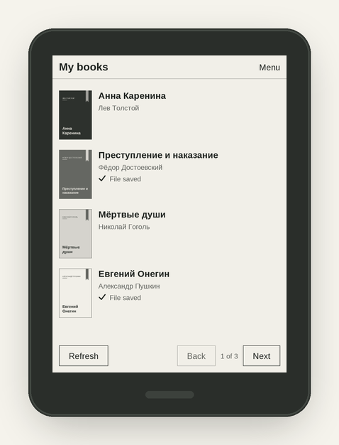

<p align="center">
  
</p>

<p align="center">
  <a href="https://github.com/ArkHak/poklio/releases/latest"></a>
  
  
  
</p>

<p align="center">
  <b><a href="#установка">Установка</a></b> ·
  <b><a href="#как-подключить-яндекс-книги">Подключение</a></b> ·
  <b><a href="#вопросы-и-ответы">Вопросы</a></b> ·
  <b><a href="#english">English</a></b>
</p>

**Poklio** — приложение для ридеров PocketBook. Подключите свою библиотеку, найдите книгу, получите её на ридер по Wi-Fi и читайте в привычной читалке. Компьютер нужен только один раз — чтобы установить Poklio.

<p align="center">
  
</p>

## Что умеет

- **Ваши книги — на ридере.** Список книг из вашей библиотеки Яндекс Книг с обложками.
- **Поиск по каталогу.** Найдите книгу и добавьте её в «Мои книги» прямо с ридера.
- **Книга в одно нажатие.** «Получить книгу» — и она на ридере, открывается в штатной читалке.
- **Вход с телефона.** Отсканируйте QR-код — пароль вводится на телефоне, а не на ридере.
- **Удобно на E Ink.** Крупные кнопки, листание физическими кнопками, цветная тема на Era Color.
- **Русский и английский** интерфейс.
- **Обновления по Wi-Fi.** Poklio подскажет, когда выйдет новая версия, и обновится, когда вы нажмёте «Обновить».

<p align="center">
  
</p>
<p align="center"><sub>Снимки экрана. Книги и обложки — для примера.</sub></p>

### Библиотеки

| Библиотека | |
|---|---|
| Яндекс Книги | Работает (экспериментально) |
| Литрес, WB Книги и другие | Может появиться позже |

Poklio проверен на **PocketBook 700 Era Color**. На других моделях PocketBook он может работать, но пока не проверялся — напишите, если попробуете.

## Установка

1. Скачайте файл **`poklio.app.bin`** со [страницы последней версии](https://github.com/ArkHak/poklio/releases/latest).
2. Переименуйте его в **`poklio.app`**.
3. Подключите ридер к компьютеру кабелем и скопируйте файл в папку **`applications`** на ридере.

Отключите кабель — Poklio появится в разделе «Приложения». Следующие версии ставятся по Wi-Fi, без компьютера.

<details>
<summary>Если у вас Mac</summary>

Finder при копировании добавляет на ридер служебный файл, и в «Приложениях» появляется лишний пункт. Чтобы этого не было, скопируйте файл через Терминал (вместо `PB700K3` — имя вашего ридера в Finder):

```bash
cp -X ~/Downloads/poklio.app /Volumes/PB700K3/applications/
```

Если лишний пункт уже появился, удалите с ридера файл `applications/._poklio.app`.
</details>

## Как подключить Яндекс Книги

Понадобятся аккаунт Яндекс Книг с подпиской и Wi-Fi. Телефон и ридер должны быть в одной сети — лучше в домашней.

1. В Poklio нажмите «Подключить библиотеку» → «Войти с телефона». На экране появится QR-код.
2. Наведите на него камеру телефона и откройте страницу.
3. Нажмите «Войти в Яндекс» и войдите в свой аккаунт.
4. Откроется страница с надписью «Авторизация в приложении Букмейт не удалась» — так и должно быть. Скопируйте адрес этой страницы целиком (подержите палец на адресной строке → «Скопировать»).
5. Вернитесь на вкладку Poklio, вставьте адрес и нажмите «Подключить».

Готово: на ридере откроются «Мои книги».

<details>
<summary>Запасной способ — через компьютер</summary>

1. На компьютере откройте [эту ссылку](https://oauth.yandex.ru/authorize?response_type=token&client_id=4483e97bab6e486a9822973109a14d05) и войдите в аккаунт Яндекса.
2. Откроется страница «Авторизация в приложении Букмейт не удалась». Скопируйте её адрес целиком.
3. Создайте текстовый файл `yandex.token` и вставьте в него адрес.
4. Подключите ридер кабелем и положите файл в папку `poklio` на ридере (она появляется после первого запуска Poklio).
5. Отключите кабель и откройте Poklio — он сам найдёт файл, подключит библиотеку и удалит файл.

В файле — доступ к вашему аккаунту: никому его не пересылайте и удалите копию с компьютера.
</details>

### Безопасность входа

- Пароль от Яндекса вводится только на сайте Яндекса — ридер его не видит.
- По Wi-Fi данные для входа передаются зашифрованными, а на ридере хранятся в зашифрованном виде.
- Страница входа работает только пока открыт экран входа и не дольше 10 минут.

Что стоит сделать самим:

- После входа удалите страницу Яндекса из истории браузера и скопируйте любой другой текст: в адресе был доступ к аккаунту.
- Входите из своей сети, а не из общественной.
- Защита на самом ридере рассчитана на случайные копии его памяти, а не на того, у кого в руках сам ридер. Если ридер потерялся или вы его отдали, отключите доступ в [Яндекс ID → «Доступы к данным»](https://id.yandex.ru/personal/data-access).

## Обновления

Раз в сутки, если есть Wi-Fi, Poklio проверяет, вышла ли новая версия. Когда она есть, в меню появится «Доступна версия…» — нажмите «Обновить», затем закройте и снова откройте Poklio. Книги, вход и настройки сохраняются. Без вашего нажатия ничего не скачивается. Автопроверку можно выключить в настройках.

Каждая версия подписана автором Poklio: файл без верной подписи ридер не установит.

## Вопросы и ответы

<details>
<summary><b>Это бесплатно?</b></summary>

Да, Poklio бесплатен для личного использования. Книги доступны в рамках вашей подписки или покупок в библиотеке.
</details>

<details>
<summary><b>Это официальное приложение Яндекса или PocketBook?</b></summary>

Нет. Poklio — независимый проект и не связан с PocketBook, Яндексом или другими компаниями. Названия сервисов указаны только чтобы было понятно, с чем он работает. Poklio пользуется неофициальным способом связи с Яндекс Книгами, поэтому подключение помечено как экспериментальное: если сервис что-то изменит, Poklio может перестать работать до обновления.
</details>

<details>
<summary><b>Можно ли получить книгу, которой нет в подписке?</b></summary>

Нет. Poklio получает только книги, которые ваш аккаунт может читать целиком. Книги, которые продаются отдельно, он не получает и ограничения сервиса не обходит.
</details>

<details>
<summary><b>Куда сохраняются книги?</b></summary>

В папку `Books/Poklio` на ридере. Они видны в обычной библиотеке PocketBook и открываются штатной читалкой. Удалить книгу с ридера можно кнопкой «Удалить файл с устройства» — в библиотеке Яндекс Книг она останется.
</details>

<details>
<summary><b>Новая версия не запускается — что делать?</b></summary>

Подключите ридер кабелем и скопируйте файл `system/state/poklio/update/poklio.app.prev` в папку `applications` под именем `poklio.app` — вернётся прежняя версия. И, пожалуйста, [напишите нам](https://github.com/ArkHak/poklio/issues).
</details>

### Известные ограничения

- Новая книга иногда появляется в библиотеке PocketBook только после перезагрузки ридера. В Poklio она открывается сразу.
- Названия и описания книг показываются на языке каталога, даже если интерфейс на английском.
- На экране блокировки обложки книг из Poklio немного обрезаны сверху и снизу.

## Сообщить об ошибке или предложить идею

[Создайте обращение](https://github.com/ArkHak/poklio/issues) и укажите модель ридера, версию прошивки и версию Poklio («Настройки» → «О приложении»). Если что-то сломалось, включите «Журнал диагностики» в настройках, повторите ошибку и приложите файл `poklio/poklio.log` с ридера. Пароли и данные для входа в журнал не попадают.

## Лицензия

Poklio бесплатен для личного использования на условиях [лицензионного соглашения](LICENSE.md). Делитесь ссылкой на эту страницу — так у всех будет последняя проверенная версия.

---

## English

<p align="center">
  
</p>

**Poklio** is an app for PocketBook e-readers: connect your library, find a book, get it onto your reader over Wi-Fi and read it in the built-in reader app. You only need a computer once, to install Poklio.

- **Your books on your reader** — your Yandex Books library with covers (experimental).
- **Catalog search** — find a book and add it to My books right on the reader.
- **Sign in with your phone** — scan a QR code; your password never reaches the reader.
- **Made for E Ink** — big buttons, page-turn keys, color theme on Era Color.
- **Updates over Wi-Fi** — when a new version is out, Poklio installs it only after you tap Update.

**Install:** download `poklio.app.bin` from the [latest release](https://github.com/ArkHak/poklio/releases/latest), rename it to `poklio.app` and copy it into the `applications` folder on your reader over USB.

**Sign in:** Connect a library → Sign in with phone, scan the QR code, sign in to Yandex and paste the address of the page you land on.

Tested on PocketBook 700 Era Color. Poklio is an independent project, not affiliated with PocketBook or Yandex. Books are available within your subscription only. Free for personal use under the [license agreement](LICENSE.md). Questions and bug reports: [issues](https://github.com/ArkHak/poklio/issues).
