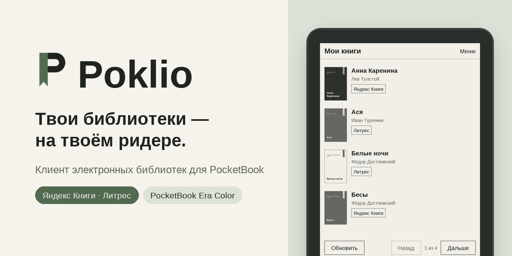
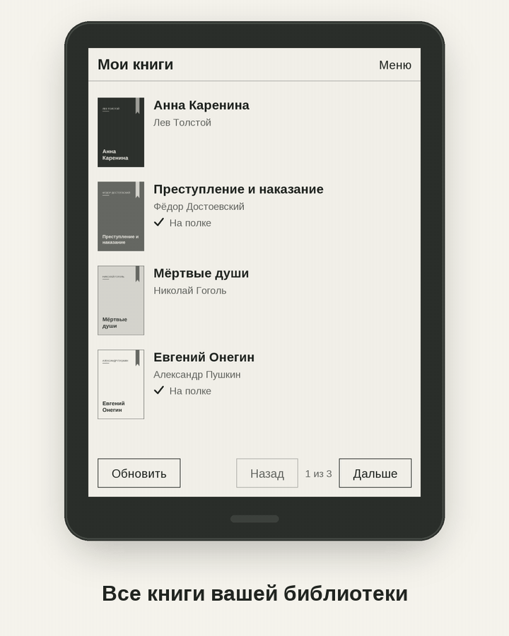
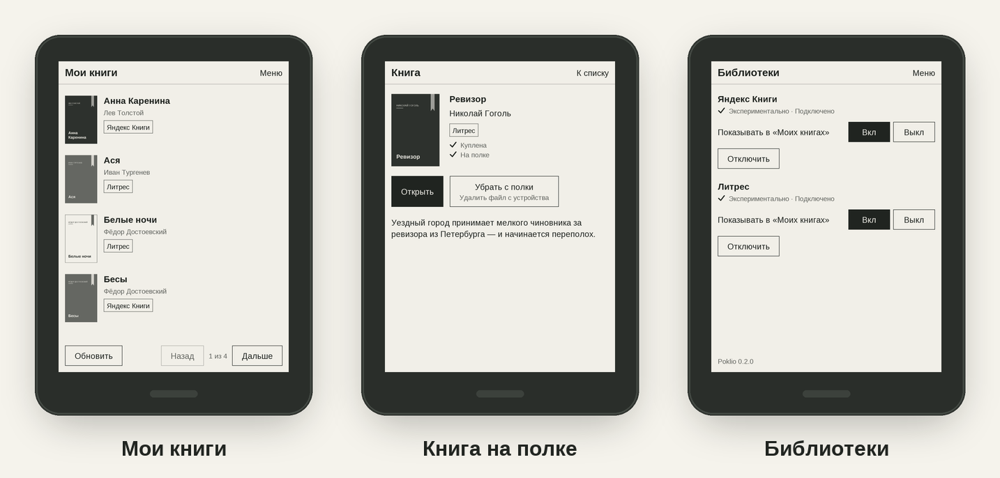
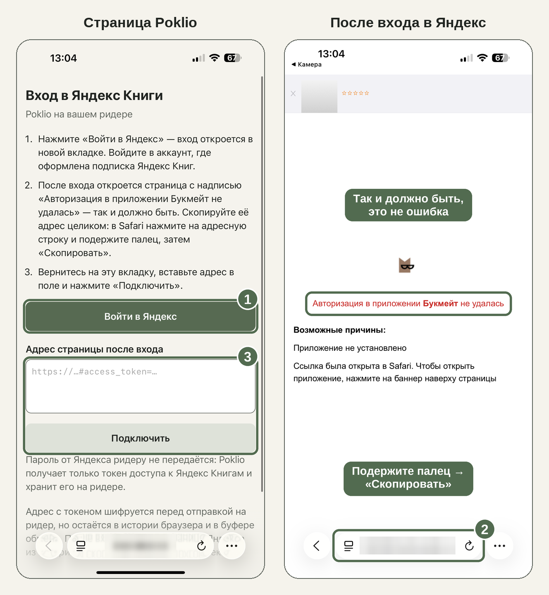

<p align="right"><b>Русский</b> · <a href="README.en.md">English</a></p>

<p align="center">
  
</p>

<h3 align="center">Книги из ваших библиотек — на PocketBook. По Wi-Fi, без компьютера.</h3>

<p align="center">
  <a href="https://github.com/ArkHak/poklio/releases/latest"></a>
  &nbsp;
  <a href="#как-начать"></a>
  &nbsp;
  <a href="#сколько-установок"></a>
</p>

<p align="center">
  
</p>

## Почему Poklio

<table>
  <tr>
    <td width="33%" valign="top">
      <b>Все библиотеки на ридере</b><br>
      Книги Яндекс Книг, Литрес и WB Книг — в одном списке, с обложками и меткой библиотеки.
    </td>
    <td width="33%" valign="top">
      <b>Книга в одно нажатие</b><br>
      «Положить на полку» — и она уже в библиотеке ридера, открывается в штатной читалке.
    </td>
    <td width="33%" valign="top">
      <b>Поиск по каталогу</b><br>
      Ищите в выбранной библиотеке и открывайте карточку книги, не беря в руки телефон.
    </td>
  </tr>
  <tr>
    <td valign="top">
      <b>Вход без пароля на ридере</b><br>
      Яндекс Книги и WB Книги — по QR-коду с телефона, Литрес — кодом из письма или приложения Литрес.
    </td>
    <td valign="top">
      <b>Сделан для E Ink</b><br>
      Крупные кнопки, физические кнопки листания, цветная тема на Era Color.
    </td>
    <td valign="top">
      <b>Обновления по Wi-Fi</b><br>
      Новая версия ставится, когда вы нажмёте «Обновить». Русский и английский интерфейс.
    </td>
  </tr>
  <tr>
    <td colspan="3" valign="top">
      <b>Место чтения синхронизируется</b><br>
      Прочитали дальше на ридере — приложение Яндекс Книг или Литрес на телефоне откроет книгу на том же месте, и наоборот. Само, когда на ридере включён Wi-Fi (экспериментально; подробнее — в разделе <a href="#вопросы">«Вопросы»</a>).
    </td>
  </tr>
</table>

<p align="center">
  
  <br><sub>Снимки экрана. Книги и обложки — для примера.</sub>
</p>

## Сколько установок

<picture>
  <source media="(prefers-color-scheme: dark)" srcset="https://raw.githubusercontent.com/ArkHak/poklio/stats/downloads.dark.svg">
  
</picture>

Число примерное: это скачивания приложения со страницы релизов без обновлений по воздуху, которые показаны отдельно. Данные обновляются раз в сутки.

## Как начать

<table>
  <tr>
    <td width="33%" valign="top">
      <b>1. Установите</b><br>
      Скачайте <code>poklio.app.bin</code> со <a href="https://github.com/ArkHak/poklio/releases/latest">страницы релиза</a>, переименуйте в <code>poklio.app</code> и скопируйте кабелем в папку <code>applications</code> на ридере.
    </td>
    <td width="33%" valign="top">
      <b>2. Подключите</b><br>
      В Poklio — «Подключить библиотеку». Яндекс Книги и WB Книги: «Войти с телефона» и QR-код. Литрес: «Войти по коду» и код из письма.
    </td>
    <td width="33%" valign="top">
      <b>3. Читайте</b><br>
      Выберите книгу в «Моих книгах», нажмите «Положить на полку», затем «Открыть».
    </td>
  </tr>
</table>

Нужны Wi-Fi и аккаунт Яндекс Книг или WB Книг с подпиской или Литрес с купленными книгами. Для входа с телефона телефон и ридер должны быть в одной сети.

<details>
<summary><b>Вход в Яндекс Книги — подробно</b></summary>

1. На ридере: «Подключить библиотеку» → «Войти с телефона». Появится QR-код.
2. Наведите на него камеру телефона и откройте страницу.
3. Нажмите «Войти в Яндекс» и войдите в аккаунт.
4. Откроется страница Яндекса с надписью «Авторизация в приложении Букмейт не удалась». **Это не ошибка**: Яндекс Книги раньше назывались Букмейт, и Poklio входит через это приложение. Доступ уже записан в адресе этой страницы — он начинается с `https://yx4483e97…oauth.yandex.ru` и содержит `#access_token=`. Скопируйте адрес целиком: подержите палец на адресной строке → «Скопировать».
5. Вернитесь на вкладку Poklio, вставьте адрес и нажмите «Подключить». На ридере откроются «Мои книги».


</details>

<details>
<summary><b>Вход в Литрес — подробно</b></summary>

1. На ридере: «Меню» → «Библиотеки» → у Литрес «Войти по коду».
2. Нажмите на поле, введите почту аккаунта Литрес и нажмите «Получить код».
3. Литрес пришлёт письмо с кодом. Введите код и нажмите «Войти» — откроются «Мои книги».

Есть приложение Литрес на телефоне — можно без письма: на экране входа нажмите «Код из приложения». В приложении Литрес: «Профиль» → «Информация для входа» → «Код для входа на сайт Литрес» → «Получить». Код действует 15 минут.

На ридер можно получить только купленные книги без защиты от копирования, и только в EPUB: если у книги на Литрес нет EPUB — например, она есть только в PDF, — Poklio её не получит. Книги по подписке Литрес читаются только в приложениях Литрес — в Poklio у них метка «Только в приложении Литрес».
</details>

<details>
<summary><b>Вход в WB Книги — подробно</b></summary>

1. На ридере: «Меню» → «Библиотеки» → у WB Книг «Войти с телефона». Появится QR-код.
2. Наведите на него камеру телефона и откройте страницу.
3. Нажмите «Войти в WB ID», войдите по номеру телефона и коду из SMS и нажмите «Принять».
4. Откроется страница WB Книг с кнопкой «Вернуться в приложение» — нажимать её не нужно. Скопируйте адрес этой страницы целиком: подержите палец на адресной строке → «Скопировать».
5. Вернитесь на вкладку Poklio, вставьте адрес и нажмите «Подключить». На ридере откроются «Мои книги».

Если после входа открылся профиль WB ID, а не страница WB Книг, вернитесь на вкладку Poklio и нажмите «Войти в WB ID» ещё раз. Код в адресе одноразовый: если он не подошёл, войдите заново.

На ридер можно получить книги, которые входят в вашу действующую подписку WB Книг; Poklio проверяет и покупки, но получение купленной книги пока не проверено. Аудиокниги в Poklio не показываются.
</details>

<details>
<summary><b>Установка на Mac</b></summary>

Finder добавляет на ридер служебный файл, и в «Приложениях» появляется лишний пункт. Копируйте через Терминал (`PB700K3` — имя ридера в Finder):

```bash
cp -X ~/Downloads/poklio.app /Volumes/PB700K3/applications/
```

Если лишний пункт уже есть, удалите с ридера файл `applications/._poklio.app`.
</details>

<details>
<summary><b>Иконка Poklio в меню — по желанию</b></summary>

Без этой настройки Poklio показывается в меню приложений со стандартной заглушкой — как любое стороннее приложение. Свою иконку прошивка берёт только из системного файла меню, а Poklio системные файлы не меняет. Поэтому иконку можно поставить вручную, если вы готовы аккуратно поправить один текстовый файл.

> **Важно.** Ошибка в этом файле может сломать меню приложений. Обязательно сделайте копию (шаг 1) — тогда всё можно вернуть за минуту. Проверено на PocketBook 700 Era Color, прошивка U700k3.6.10.2359; на других прошивках файл может быть устроен иначе.

**1. Сделайте копию.** Подключите ридер кабелем и скопируйте на компьютер два файла из папки `system/config/desktop/` на ридере: `view.json` и `hash.txt`.

**2. Положите иконки.** Скачайте [poklio.bmp](https://github.com/ArkHak/poklio/raw/main/icons/poklio.bmp) и [poklio_f.bmp](https://github.com/ArkHak/poklio/raw/main/icons/poklio_f.bmp) (вторая показывается при нажатии). На ридере в папке `applications` создайте папку `icons` и положите туда оба файла.

**3. Откройте `system/config/desktop/view.json`** в простом текстовом редакторе: VS Code, Notepad++, «Блокнот» или TextEdit в режиме «Простой текст». Word и похожие программы не подходят.

**4. Добавьте описание Poklio.** Найдите в начале файла строку `"applications": {`. Сразу под ней вставьте этот блок — обратите внимание на запятую в конце:

```json
        "U_poklio": {
            "path": "/mnt/ext1/applications/poklio.app",
            "title": "Poklio",
            "icon": "/mnt/ext1/applications/icons/poklio.bmp",
            "focused_icon": "/mnt/ext1/applications/icons/poklio_f.bmp"
        },
```

Должно получиться так:

```json
    "applications": {
        "U_poklio": {
            "path": "/mnt/ext1/applications/poklio.app",
            "title": "Poklio",
            "icon": "/mnt/ext1/applications/icons/poklio.bmp",
            "focused_icon": "/mnt/ext1/applications/icons/poklio_f.bmp"
        },
        "_comment": [
            ...
```

**5. Добавьте Poklio в меню.** Ниже, в разделе `"view"`, найдите группу `"title": "@General"` и её список `"apps"`. Поставьте запятую после последнего элемента списка и допишите `"U_poklio"`:

```json
                "apps": [
                    "PB_AudioBooks",
                    ...
                    "PB_Settings",
                    "U_poklio"
                ]
```

**6. Сохраните файл** (кодировка UTF-8) и проверьте мелочи: все кавычки прямые `"`, запятые стоят между элементами, но не после последнего. Файл `hash.txt` не меняйте — прошивка обновит его сама.

**7. Отключите ридер.** Иконка появится в меню приложений. Если нет — перезагрузите ридер.

**Если на Mac** Finder добавил служебные файлы, удалите их, иначе в меню может появиться лишний пункт:

```bash
rm /Volumes/PB700K3/applications/icons/._*
```

**Если что-то пошло не так** — меню не открывается, пропали приложения или Poklio не запускается — подключите ридер и верните на место `view.json` и `hash.txt` из копии, затем перезагрузите ридер.
</details>

<details>
<summary><b>Запасной вход — через компьютер</b></summary>

1. На компьютере откройте [эту ссылку](https://oauth.yandex.ru/authorize?response_type=token&client_id=4483e97bab6e486a9822973109a14d05) и войдите в Яндекс.
2. На странице «Авторизация в приложении Букмейт не удалась» скопируйте адрес целиком.
3. Сохраните его в текстовый файл `yandex.token` и положите кабелем в папку `poklio` на ридере (она появляется после первого запуска Poklio).
4. Откройте Poklio — он подключит библиотеку и удалит файл.

В файле — доступ к аккаунту: не пересылайте его и удалите копию с компьютера.
</details>

## Безопасность

<table>
  <tr>
    <td width="50%" valign="top">
      <b>Что защищено</b>
      <ul>
        <li>Пароль вводится только на сайте Яндекса — ридер его не видит. Для Литрес пароль не нужен: вход кодом, код уходит прямо в Литрес. В WB Книги вход по коду из SMS — только в браузере телефона, на ридер приходит одноразовый код входа.</li>
        <li>Данные для входа идут по Wi-Fi зашифрованными и хранятся на ридере зашифрованными.</li>
        <li>Страница входа работает, только пока открыт экран входа, и не дольше 10 минут.</li>
        <li>Обновление без верной подписи автора ридер не установит.</li>
      </ul>
    </td>
    <td width="50%" valign="top">
      <b>Что стоит сделать самим</b>
      <ul>
        <li>После входа удалите страницу Яндекса или WB Книг из истории браузера и скопируйте любой другой текст.</li>
        <li>Входите из своей сети, а не из общественной.</li>
        <li>Защита на ридере — от случайных копий его памяти, а не от того, у кого сам ридер. Потеряли или отдали ридер — отключите доступ в <a href="https://id.yandex.ru/personal/data-access">Яндекс ID → «Доступы к данным»</a>; для Литрес обратитесь в поддержку Литрес, чтобы завершить сеансы; для WB Книг завершите сеанс в профиле WB ID («Сеансы»).</li>
      </ul>
    </td>
  </tr>
</table>

## Вопросы

<details>
<summary><b>Это официальное приложение Яндекса, Литрес, Wildberries или PocketBook?</b></summary>

Нет. Poklio — независимый проект и не связан с PocketBook, Яндексом, Литрес, Wildberries или другими компаниями; названия сервисов указаны только для совместимости. Связь с Яндекс Книгами, Литрес и WB Книгами неофициальная, поэтому подключение помечено как экспериментальное: если сервис что-то изменит, Poklio может перестать работать до обновления.
</details>

<details>
<summary><b>Можно ли получить книгу, которой нет в подписке?</b></summary>

Нет. Poklio получает только книги, которые ваш аккаунт может читать целиком, и не обходит ограничения сервиса. В Литрес это купленные книги; книги по подписке Литрес на ридер получить нельзя — сервис отдаёт их только своим приложениям. В WB Книгах — книги вашей действующей подписки и купленные книги. Доступ после окончания подписки Poklio не обещает; уже полученные файлы остаются на ридере.
</details>

<details>
<summary><b>На каких ридерах работает?</b></summary>

Нужна прошивка 6.8 или новее. Poklio 0.1.0 на прошивке 6.8 не запускался — исправлено в 0.1.1. По отчёту пользователя запускается и работает также на прошивке 6.5 (PocketBook X).

Проверенные модели:

| Модель | Прошивка | Poklio | Что проверено | Дата | Кто проверил |
|---|---|---|---|---|---|
| PocketBook 628 Touch Lux 5 | — | — | Яндекс Книги: вход и чтение | 2026-10-23 | Пользователь |
| PocketBook 740 InkPad 3 | — | — | Яндекс Книги: вход и чтение | 2026-10-23 | Пользователь |
| PocketBook 700 Era Color (PB700K3) | U700k3.6.10.2359 | 0.1.1 → 0.4.1 | Все возможности: Яндекс Книги и Литрес, синхронизация места с обоими в обе стороны, домашняя страница, тёмный режим, обновление по воздуху | 2026-10-19—24 | Автор |
| PocketBook X (PB1040) | U1040.6.5.1701 | 0.2.1 → 0.3.0 | Вход с телефона, получение и открытие книг, обложки, поиск, обновление по воздуху, кнопки листания | 2026-10-21—22 | Пользователь |
| PocketBook 634 Verse Pro Color (PB634K3) | 6.10 | 0.2 | Литрес: вход, получение купленных книг | 2026-10-21 | Пользователь |
| PocketBook 700 Era (PB700) | U700.6.8.4183 | 0.1.1 | Запуск и работа | 2026-10-19 | Пользователь |

На других сенсорных PocketBook с прошивкой 6.8 и новее Poklio, скорее всего, работает, но пока не проверялся. Попробовали на своём ридере — [заполните отчёт о модели](https://github.com/ArkHak/poklio/issues/new?template=device-report.yml): он попадёт в эту таблицу.
</details>

<details>
<summary><b>Какие библиотеки поддерживаются?</b></summary>

Яндекс Книги, Литрес и WB Книги (все — экспериментально). Можно подключить все сразу: «Мои книги» покажут книги всех с меткой библиотеки, а на экране «Библиотеки» любую можно скрыть, не отключая.
</details>

<details>
<summary><b>Где хранятся книги и как их удалить?</b></summary>

В папке `Books/Poklio`: они сразу видны в библиотеке PocketBook. «Убрать с полки» в карточке удаляет файл, в библиотеке Яндекс Книг или аккаунте Литрес и WB Книг книга остаётся. Все книги на ридере — в разделе меню «На полке», он работает без сети.
</details>

<details>
<summary><b>Как работают обновления?</b></summary>

Раз в сутки, если есть Wi-Fi, Poklio проверяет новую версию. Если она есть, в меню появится «Доступна версия…»: нажмите «Обновить», затем закройте и откройте Poklio — книги, вход и настройки сохранятся. Автопроверку можно выключить в настройках.

Если новая версия не запускается, подключите ридер кабелем и скопируйте `system/state/poklio/update/poklio.app.prev` в папку `applications` под именем `poklio.app` — вернётся прежняя.
</details>

<details>
<summary><b>Синхронизируется ли место, где я остановился?</b></summary>

Да, у Яндекс Книг и Литрес — в обе стороны (экспериментально). Прочитали дальше на ридере — приложение на телефоне откроет книгу на том же месте. Прочитали дальше на телефоне — штатная читалка ридера откроет книгу там, где вы остановились. «На полке» и в карточке книги видно «Прочитано N %». Литрес при открытии книги может спросить, продолжить ли с места, где вы читали на другом устройстве (Poklio), — ответьте «Да».

Всё происходит само, без кнопок: когда Poklio открывается и когда вы возвращаетесь в него из читалки, если на ридере включён Wi-Fi. Пока синхронизация идёт, в заголовке видно «Синхронизируем…»; после читалки ридер подключается к Wi-Fi не сразу, поэтому процент может обновиться через несколько секунд. Прогресс только растёт: если вернуться в книге назад, Poklio не перенесёт это место ни на телефон, ни на ридер.

Лучше всего открывать книги из Poklio — с полки или из карточки книги: тогда после чтения вы возвращаетесь в Poklio, и место синхронизируется сразу. Если открыть книгу из библиотеки ридера, место синхронизируется при следующем запуске Poklio.

Кнопка «Синхронизировать прогресс» в карточке книги — запасной вариант, чтобы синхронизировать сразу, например если Wi-Fi был выключен. Нажимать её не обязательно.

Синхронизируются книги, положенные на полку через Poklio. WB Книги — пока без синхронизации.
</details>

<details>
<summary><b>Известные ограничения</b></summary>

- Названия и описания книг — на языке каталога, даже при английском интерфейсе.
- Литрес: вход — по почте или кодом из приложения; вход по номеру телефона пока недоступен.
- Литрес: книги получаются только в EPUB. Купленная книга, у которой нет EPUB (например, только PDF), на ридер не попадёт; выбрать другой формат, например FB2, пока нельзя.
- На экране блокировки обложки книг из Poklio немного обрезаны сверху и снизу.
</details>

<details>
<summary><b>Нашли ошибку?</b></summary>

[Сообщите об ошибке](https://github.com/ArkHak/poklio/issues/new?template=bug-report.yml): модель ридера, версия прошивки, версия Poklio («Настройки» → «О приложении») и что произошло. Помогает журнал: включите «Журнал диагностики» в настройках, повторите ошибку и приложите файл `poklio/poklio.log` с ридера — паролей и данных для входа в нём нет.
</details>

---

<p align="center">
  <sub>
    Poklio — независимый проект. Распространяется на условиях <a href="LICENSE.md">лицензионного соглашения</a>.<br>
    Делитесь ссылкой на эту страницу — так у всех будет последняя проверенная версия.
  </sub>
</p>
